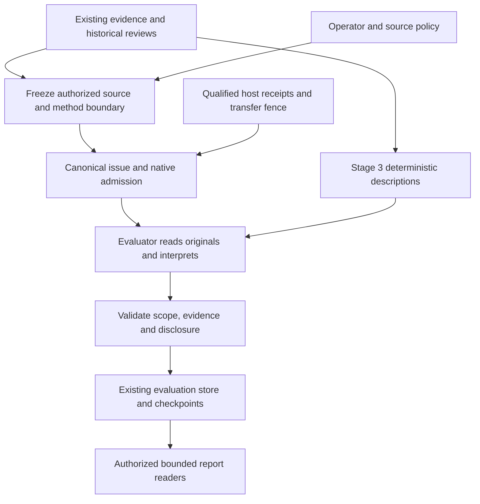

# Stage 4: whole-objective learning and host qualification contract

## Decision and delivery boundary

**Build Stage 4 as a distinct, source-grounded Evaluator method over the existing evidence and evaluation stores. Preserve Stage 3's deterministic descriptions. First implement the Loom preparation and validation boundary; qualify native execution and protected transfer before enabling the capabilities that require them.**

Fresh investigation still finds Q4 **partial/unqualified** and Q5 **unsupported/unqualified**. This includes the newly released OpenCode 2.3.0 source, rather than assuming the old 2.2.6 findings remain true. The installed 2.2.6 probe reproduced the protected-inline-transfer counterexample. OpenCode 2.3.0's asynchronous subagent reporting does not supply the missing request-to-execution edges or source-transfer authority.

This document is a **proposed Stage 4 implementation contract**, derived from the accepted behavior below. It is not a claim that Stage 4 is implemented or qualified. This assignment changes documentation only: no upstream changes, dependency upgrade, real-model dispatch, retention expansion or Stage 4 production implementation. [Issue #227](https://github.com/bateau84/loom/issues/227) remains open.

**Subsequent implementation:** The user selected this contract for the next assignment. The [durable preparation increment](learning-stage4-preparation.md) implements a bounded part of section 6 with dispatch unavailable. The documentation-only stop point below records the original PR #235 assignment; it is not a claim that no later implementation exists.

Example: three Coder handbacks concern one goal. The first two fail later verification; the third fixes the defect. R1 reviewed artifact A for security, while R2 checked only the correction in B. An Evaluator should explain the whole trajectory, recovery, useful practices and remaining uncertainty. It must neither count three wins nor promote either scoped review into general acceptance. It can conclude that no system change is justified.

## Derived from

- [Accepted review-scoped evidence architecture](learning-evidence-and-review-scope.md), including its E1–E14 acceptance scenarios and permission for useful qualified analysis with unknown independence.
- [Native evidence specification](learning-native-evidence-spec.md): immutable mandates, historical WorkRefs, canonical issue intents, evidence relationships, authorization and uncertain native effects.
- [Whole-work behavior](requirements/learning-retrospectives/br-007-prioritize-whole-work-learning.md), [automatic evaluation](requirements/learning-retrospectives/br-006-run-evaluation-automatically.md), [revisable history](requirements/learning-retrospectives/br-008-persist-revisable-evaluation-history.md), and [controlled recommendations](requirements/learning-retrospectives/br-009-present-controlled-system-improvements.md).
- [Native provenance](requirements/learning-retrospectives/oc-001-host-observation-and-dispatch-provenance.md), [review basis](requirements/learning-retrospectives/oc-002-review-admission-and-evidence-basis.md), [protected access](requirements/learning-retrospectives/oc-003-protected-source-and-derived-report-access.md), and [publication meaning](requirements/learning-retrospectives/oc-004-evaluation-processing-and-publication.md).
- [Native review qualification](native-review-qualification.md), [host trust contract](learning-host-trust-contract.md), and the merged [Stage 3 playbook](learning-automatic-stage3.md).

The native evidence specification explicitly carries the user-accepted BR/QS/OC baseline forward. Older “proposed” or “not implemented” labels in the original requirements describe their historical authoring stage; they neither undo accepted intent nor prove current implementation. This contract adds realization and conformance detail, not a new objective or an authorization to activate it.

## 1. Evidence and current host capability

### 1.1 Exact inspected and executed versions

| Component | Exact identity | Evidence level |
| --- | --- | --- |
| Loom Stage 3 | `e1c6a66c4c6ff2d23881c07533715d59a45000a1`, merged PR #233 | Source inspected; clean source packed and installed for this investigation |
| OpenCode pinned host | 2.2.6, source `dc2ffcf8bf26f9e669b6aa22b95f50e12be15e06` | Source inspected and actual installed CLI exercised; binary hash is separate from Git source identity |
| OpenCode current release | 2.3.0, source `a6b15d33daf6ab7d35569f6d711fdb630b9f04e7` | Fresh source inspection; no installed 2.3.0 qualification or Loom upgrade claimed |
| OpenCode development snapshot | `d432a06b9c07bab0be4e8d642173b1cb14137f11` | Admission/runner/authorization paths inspected retain the same guarantees. The expanded inventory differs only in `read.ts` zero-limit rejection and blank-line rendering; not installed qualification or whole-repository equivalence. |

The [Stage 4 evidence record](learning-stage4-host-evidence.json) preserves the run identities, source inventory, input/runtime hashes, all eight checks and their narrower qualification results. The local runner used Bun 1.4.2, Node 24.22.1 and Python 3.12.14; the installed host's own reported runtime was Bun 1.4.4 / Node compatibility 26.3.0. These are different observations, not interchangeable version labels.

Fresh execution of the unchanged `tests/installed_native_review.py` at the clean Loom baseline completed **8/8 expected mechanical checks**, with **1,144 finalized audit receipts**. `execution_status: PASS` means the observations matched the expected mechanisms and counterexamples. Overall `status: UNQUALIFIED`, Q4's `same_review_invocation: UNQUALIFIED`, and Q5's `native_recipient_transfer_property: FAIL` remain controlling. The 19 existing oracle tests also passed. Only a local scripted provider saw synthetic sources; no real-model reasoning, provider billing, original operator history or human consent was tested.

The fixture contains historical wording about unimplemented review admission. On current Loom, immutable local requests and issue-intent persistence **are implemented**; native qualified issue/delivery is the missing integration. Its fixture-authored mandates are still not evidence that that missing integration ran. One earlier invocation was started before the isolated plugin installation finished and failed prerequisite inventory; it ran no native scenario and is not counted as qualification.

### 1.2 Q4: actual request, execution and evidence

| Guarantee | Supported today | Missing guarantee and owner |
| --- | --- | --- |
| Parent invocation → child Session | Direct native tool tuple, progress/terminal metadata and checked child parentage. | A child is a container, not an admitted review. **OpenCode admission** must bind the actual parent invocation to the actual child input. |
| Exact admitted input | Native inbox ID, durable enqueue/readback and first-admission-wins replay. The prompt hook exposes that input ID. | Native `subagent` discards the actual prompt result and passes no protected parent-call identity. Caller metadata cannot fill the edge. |
| Admitted input(s) → model/tool work | Native assistant steps and direct tool calls have identities. | **OpenCode inbox/runner** must carry the contributing admitted-input set into each step and its tools/results. Session coincidence, FIFO or timestamps are insufficient. |
| Supplied material | The installed probe observes actual bytes at the local AI SDK `doStream` boundary with a native Session header; pointer-only input has no source supply. | Same-admitted-execution linkage is missing. **Host/provider adapter** must expose the exact named-boundary relationship; final transport exposure needs its own evidence only when claimed. |
| Retrieved source | A real authorized native `read` returns bytes under its child Session/assistant message/call tuple. | **Host runner and source tool** must connect that return to the admitted execution and exact returned version/coverage. A completed generic tool or citation cannot substitute. |
| Reused/background child | Distinct parent calls remain observable; 2.3.0 adds durable asynchronous reporting periods/outboxes. | **Host job/runner** must connect results/notices to contributing inputs. A joined job or reporting period is not one independent result per dispatch. |
| Code Mode inner work | Outer tool identity and some actual results are observable. | Inner calls share the outer native context. **OpenCode Code Mode** must expose unique inner invocation IDs for exact inner attribution, or this route remains explicitly opaque. |

Decisive 2.3.0 source: [subagent prompt and return](https://github.com/anomalyco/opencode/blob/a6b15d33daf6ab7d35569f6d711fdb630b9f04e7/packages/core/src/tool/plugin/subagent.ts#L194-L239), [inbox promotion](https://github.com/anomalyco/opencode/blob/a6b15d33daf6ab7d35569f6d711fdb630b9f04e7/packages/core/src/session/inbox.ts#L539-L587), [runner context construction](https://github.com/anomalyco/opencode/blob/a6b15d33daf6ab7d35569f6d711fdb630b9f04e7/packages/core/src/session/runner/llm.ts#L191-L219), [tool execution and later truncation](https://github.com/anomalyco/opencode/blob/a6b15d33daf6ab7d35569f6d711fdb630b9f04e7/packages/core/src/session/runner/step.ts#L118-L153), and [Code Mode context reuse](https://github.com/anomalyco/opencode/blob/a6b15d33daf6ab7d35569f6d711fdb630b9f04e7/packages/core/src/codemode/tool.ts#L127-L140).

The current [model/HTTP/WebSocket hooks](https://github.com/anomalyco/opencode/blob/a6b15d33daf6ab7d35569f6d711fdb630b9f04e7/packages/plugin/src/promise/session.ts#L15-L145) offer useful observations, but not the missing input/step relation. [Later request shaping](https://github.com/anomalyco/opencode/blob/a6b15d33daf6ab7d35569f6d711fdb630b9f04e7/packages/core/src/session/model-request.ts#L338-L349) can change content after context hooks. [Job joining](https://github.com/anomalyco/opencode/blob/a6b15d33daf6ab7d35569f6d711fdb630b9f04e7/packages/core/src/job.ts#L362-L397), [recovery fields](https://github.com/anomalyco/opencode/blob/a6b15d33daf6ab7d35569f6d711fdb630b9f04e7/packages/core/src/job/recovery.ts#L11-L17), and [period result selection](https://github.com/anomalyco/opencode/blob/a6b15d33daf6ab7d35569f6d711fdb630b9f04e7/packages/core/src/session/execution/subagent-report.ts#L130-L185) do not repair the missing edges.

Loom already preserves the distinction: [review relationships](../src/review-requests.ts) validate unknown native binding and only recognize tightly instrumented companion retrieval; [issue state](../src/review-issues.ts) reports unavailable native causal receipts. A new locally generated token, signature, hash or inferred child association must not upgrade these records.

### 1.3 Q5: protected transfer into the actual recipient

**Native read denial works for that read. It is not an incoming-content fence.** The fresh probe observed requester A read synthetic source B, Reviewer C receive a real native read denial, then the same C receive B inlined by A while C's read remained denied. The actual provider-bound fixture observation, rather than C's claimed inspection, establishes that counterexample.

| Entry/exit path | Actual current mechanism | Required owner of the missing fence |
| --- | --- | --- |
| Native `read` | Permission uses the actual calling Session/agent/message/call. | Source owner checks exact source/version and **recipient transfer**, separately from source read. |
| Ordinary prompt and attachments | Mutable prompt hook, then text/file/media/skill preparation and admission. | Host must authorize every incoming content class before recipient persistence/admission. |
| Synthetic input and background reports | Synthetic admission bypasses ordinary prompt preparation; 2.3.0 sends child conclusions to parent this way. | Host must cover synthetic input and both directions of derived-result transfer. |
| Instruction entries and discovered instructions | API entries and instruction files can become model-visible instructions. | Host/source owner must mediate or disable these paths in the protected profile. |
| History, imports, forks and compaction | Stored context and summaries can reintroduce earlier material. | Host must enforce recipient eligibility during context reuse and resume, not just on the first prompt. |
| Native/custom/MCP/Code Mode tool results | Tool hooks permit observation/transformation; generic output carries no universal source policy. | Host must expose an unavoidable pre-return gate; unqualified tools must be unavailable in the protected profile. |
| Reports, previews, identifiers and counts | Loom's existing readers protect their present owner scope. | Loom and source authority must preserve source-derived restrictions on new cross-Session results and metadata. |

Current source evidence: [native file permission](https://github.com/anomalyco/opencode/blob/a6b15d33daf6ab7d35569f6d711fdb630b9f04e7/packages/core/src/file-access.ts#L139-L155), [effective agent/Session rules](https://github.com/anomalyco/opencode/blob/a6b15d33daf6ab7d35569f6d711fdb630b9f04e7/packages/core/src/permission.ts#L169-L209), [prompt/attachment preparation](https://github.com/anomalyco/opencode/blob/a6b15d33daf6ab7d35569f6d711fdb630b9f04e7/packages/core/src/session/prompt.ts#L34-L220), [synthetic admission](https://github.com/anomalyco/opencode/blob/a6b15d33daf6ab7d35569f6d711fdb630b9f04e7/packages/core/src/session/session.ts#L286-L325), [background result delivery](https://github.com/anomalyco/opencode/blob/a6b15d33daf6ab7d35569f6d711fdb630b9f04e7/packages/core/src/session/subagent-completion.ts#L55-L80), [entry writes](https://github.com/anomalyco/opencode/blob/a6b15d33daf6ab7d35569f6d711fdb630b9f04e7/packages/server/src/handlers/session.ts#L560-L579), [entry rendering](https://github.com/anomalyco/opencode/blob/a6b15d33daf6ab7d35569f6d711fdb630b9f04e7/packages/core/src/session/instruction-entry.ts#L94-L165), and [tool-result hooks](https://github.com/anomalyco/opencode/blob/a6b15d33daf6ab7d35569f6d711fdb630b9f04e7/packages/core/src/tool.ts#L133-L180). These APIs are trusted host capabilities; this finding does not assert unauthenticated access.

Permission evaluation, prompt preparation, ordinary/synthetic Session admission, instruction entries and file-access authorization are unchanged between the inspected 2.2.6 and 2.3.0 sources. Agent/model switching of an existing child already existed in 2.2.6; only always-background dispatch and revised result reporting are new here. The extra ingress paths above are source findings, not additional installed 2.3.0 exploit demonstrations.

## 2. Minimum host/API changes

### 2.1 Alternatives and selected boundary

| Option | Mechanism and benefit | Cost, failure path and disposition |
| --- | --- | --- |
| Loom-only observation and withholding | Preserve present hooks, frozen requests and same-owner readers; refuse unsupported transfer. Useful preparation can ship independently. | Cannot bind missing native edges or stop alternate native ingress. Keep as the current safe fallback; insufficient for full Q4/Q5. |
| Host causal receipts plus a sealed review profile | Extend existing admission/runner events; create a fresh recipient whose content comes only through a trusted source broker and whose results are references until authorized for disclosure. | Requires host changes across admission, context, tools and results, plus source-specific policy. A missed alternate path breaks confidentiality. **Selected minimum for protected Stage 4.** |
| General information-flow enforcement | Label all source-derived content and conservatively propagate labels through arbitrary conversations/tools, with separate declassification. Supports freer delegation. | Much broader policy/runtime work; copied, encoded and paraphrased model text cannot be classified reliably by substring matching. A missing label can leak across any channel. Defer beyond the minimum profile. |

A fresh child by convention or a late prompt scrubber is not another sufficient alternative: existing APIs can add inputs, change the agent and inject entries or synthetic content. The selected profile needs host enforcement, not an instruction asking agents to cooperate. It does not require a new general orchestrator, global ACL product or Loom evidence database.

### 2.2 H4: host-owned causal receipts

The following names define **proposed semantic records, not existing endpoints or SDK methods**. Reuse native IDs, event storage and authorized read APIs where possible. Every record has a common format/capability version, host/source-store namespace and immutable native receipt identity; referenced input/step/tool/result IDs are scoped to that namespace. OpenCode owns issuance and immutable linkage; Loom owns validation and association with its frozen local request.

| Record | Required fields and meaning |
| --- | --- |
| `AdmissionReceipt` | Version; host/source-store namespace; native recipient Session/input ID; effective agent/configuration identity; exact admitted payload digest/reference; actual parent native tool key or explicit `none/unknown`; admission event identity. The parent key comes from the host's invocation context, never public metadata. |
| `StepBasisReceipt` | Native assistant-step identity; execution kind (`engineering`, `analysis`, or explicitly unknown under the admitting host contract); the exact active admitted-input set; native context boundary; prior continuation relation when applicable. Distinguish active/steered contributors from old messages merely present in history. |
| `EvidenceReceipt` | Native step/tool or admission identity; exact source/version; coverage; actual named boundary; source authorization decision/reference; host event identity. Record `supplied` and `retrieved` separately. Inline bytes do not imply a read; citations do not imply either. |
| `ResultReceipt` | Actual source assistant result; its input/step contributors; terminal state; delivery/notification identity when asynchronous. A notification ID identifies delivery, not a new review or originating goal. |

Receipt rules:

1. Admission linkage must commit with native admission, or be reconstructible from the same durable native transaction. Retaining a prompt return only in a plugin callback leaves a crash gap. A prompt-hook observation followed by rejection remains a pre-admission exposure fact, not successful admission.
2. Inbox promotion supplies exact IDs, not only a count. The runner carries contributors across subsequent steps, tools, errors, cancellation and continuation. Joined steering records the set; no consumer may split one shared result into several separately completed reviews. Queued later work receives its own basis.
3. Native source returns identify the actual returned bytes/version, including excerpt ranges or an exact excerpt reference. Receipt generation is at that boundary, not reconstructed from requested filenames. Tool truncation and provider shaping require separately named later observations when relevant.
4. Exact inner-call claims require distinct host-issued Code Mode inner IDs with the outer parent relation. Until then, direct qualified source tools can serve the selected profile; opaque inner work remains unavailable for stronger evidence claims.
5. Protected read-only lookup must survive restart/compaction. Imported, old, missing or inconsistent receipts remain unknown/ambiguous. Same event ID with different payload is a conflict, never an overwrite. Editable exports and Loom-generated signatures do not authenticate a native fact.
6. Advertise a versioned capability/profile and its supported routes. Unknown required meaning disables only the dependent claim/effect. Ordinary engineering and Stage 3 must remain usable. A later host version requires affected requalification.

This establishes operational provenance, not model comprehension. A `tool-return` receipt can qualify retrieved material without universal HTTP-wire attestation. A claim about final provider input must additionally identify the actual adapter/transport attempt after its relevant transformations; no earlier receipt is relabelled to imply it.

### 2.3 H5: sealed, recipient-authorized source delivery

The source owner or an explicitly authorized evidence service may retain policy ownership. OpenCode must provide the immutable recipient identity and enforcement boundaries; Loom must not create an ACL by assuming that a parent, project member or configured Reviewer name inherits access.

Proposed operations can be capabilities on existing native APIs. Two implementers must agree on these semantics:

| Operation | Input and authority | Atomic effect / observable result |
| --- | --- | --- |
| Prepare recipient | Loom source-store namespace plus canonical issue key; qualified host profile; exact agent/configuration and model-route policy; trusted authority reference. Model-visible callers supply only opaque approved references and bounded non-content controls. | Durably map that namespaced intent to one fresh sealed recipient, or return the existing identical binding. Conflicting recipient/method bindings reject. Preparation admits no source bytes or model work. |
| Admit review | Prepared recipient capability; immutable mandate/method/source handles; exact versions; purpose; applicable source-policy decisions. | Trusted broker resolves and authorizes content, then commits a one-use admission with H4 linkage. Return `admitted`, `existing` for identical replay, `denied`, `unsupported`, or explicit `unknown` after an uncertain acknowledgement. Changed bytes are a conflict. |
| Return source | Host invocation context plus an allowed opaque source handle and bounded range. | Source authority validates actual recipient, current policy and exact returned version before any recipient-visible persistence/return; record H4 evidence or a policy-permitted gap. No successful empty-source receipt on denial. |
| Read receipt/result | Authenticated native principal, record identity and requested bounded view. | Apply source-derived disclosure policy before revealing bodies, IDs, counts or pages. An authorized result is immutable; broader release requires a separate declassification decision. |

Recipient preparation and admission use the same namespaced issue identity. The host retains the intent→recipient→admission mapping durably; identical request IDs in different Loom stores never alias. An admission retry retrieves that mapping and cannot allocate another recipient or execute again merely because its acknowledgement was lost.

**The mandate is content too.** Original question, criteria, exclusions, WorkRef text, titles, methodology and error messages can contain protected material. The broker must authorize their actual bytes/dependencies for the recipient. An existing requester-authored request is not inherently safe because its attachments use handles. Unknown classification withholds that input. Arbitrary parent text, including encoded or paraphrased copies, is not admitted through a supposedly “non-content” control. Supporting free text from a parent that has seen protected sources requires conservative sender dependency propagation or explicit declassification, outside this minimum profile.

The host must seal all alternative writes and source paths for that recipient: ordinary prompt, synthetic input, entries, file/data/media/skill attachments, import/fork/history reuse, discovered instructions and plugin/context injection. Allow only qualified source, methodology and bounded result tools. Shell, generic network, unmediated MCP, ordinary unrestricted native reads and opaque Code Mode remain unavailable unless separately qualified to equivalent enforcement. Compaction, title generation and other auxiliary requests either use the same source/route policy or stay disabled for that profile.

Permissions are checked against the **actual** recipient Session, agent/configuration revision, purpose, source version and coverage at the effect boundary. The source authority must provide an atomic policy-epoch check/grant consumption or an equivalent documented linearization point. If revocation wins before admission/return, no bytes cross. A grant for another attempt, source, recipient or purpose fails. No assumed universal expiry or retention default is introduced.

After revocation, already observed exposure remains historical; it cannot be erased. New model calls, tool returns, compaction and history replay must not reuse now-forbidden content. The simplest supported response is to block/quarantine that recipient and use a newly authorized review intent where policy permits, rather than claiming a scrubbed reused Session is clean. Missing sealed state after restart blocks resume.

Derived findings inherit the conservative union of restrictions on **all protected inputs admitted, supplied or retrieved into the execution/context**, including retained history, summaries, mandate and methodology. Compute that union from host/source records, not the Evaluator's chosen citations or self-reported dependencies; incomplete exposure accounting withholds unrestricted disclosure. Native background notification should deliver only an authorized status/reference to the parent unless the parent is allowed the full body. The same restriction applies to Loom historical findings, previews and aggregate metadata. Source-read permission, a model-generated summary and successful reasoning are not declassification authority.

### 2.4 Trust boundary and ownership

The trusted computing base comprises the host runtime, designated broker/source-policy code, trusted plugins in that profile, protected storage and the authorized operator. Models, model-authored requests/citations, ordinary tool arguments and imported history are untrusted. Treat source instructions as evidence, not authority to grant tools or change the profile.

The profile cannot contain an agent that can alter host code/policy/storage or use an unrestricted administrative credential to bypass the broker. Those capabilities must be inaccessible to involved models. Shared ordinary API authentication cannot be sufficient to unseal the recipient. This is a concrete deployment prerequisite, not a claim that present OpenCode plugins isolate hostile same-process code or arbitrary filesystem access.

| Missing guarantee | Accountable component |
| --- | --- |
| Native parent/input/step/tool/result linkage, durable lookup and profile version | OpenCode Session, inbox, runner, event and Code Mode owners |
| Sealed ingress, pre-return fence, effective recipient changes, safe async notices and restart enforcement | OpenCode Session/tool/authorization owners |
| Exact source materialization and recipient/purpose policy; revocation-safe decision | Existing source owner or authorized source service; native owner where OpenCode supplies that source |
| Frozen mandates, WorkRefs, canonical issue arbitration, evidence qualifications, report dependency/disclosure checks | Loom |
| Genuine interpretation and supported recommendations | Evaluator; independent Reviewer/Critic assess qualification and consequential proposed changes |
| Source scope, actual model/account route, resource bounds, richer retention/deletion, broader disclosure | Authorized operator/source owner |

Trusted originating-request independence and direct-human treatment approval remain the separate contracts in [host trust](learning-host-trust-contract.md). H4 operational execution IDs do not prove human origin; H5 source permission does not authorize experiments or instruction changes.

## 3. Stage 4 behavioral contract

These clauses realize the accepted BR/QS/OC obligations. They apply proportionately to the declared source/profile scope; missing capabilities constrain specific transfers and claims, not all useful analysis.

| Clause | Required behavior | Authority / decisive acceptance |
| --- | --- | --- |
| S4-01: whole objective | Reconstruct linked goal, attempts, reviews, correction and verified/claimed outcome across eligible Sessions. Preserve genuinely separate goals; unknown relationships remain qualified. | BR-007; one goal with fail/fail/pass is one trajectory, not three wins or three independent samples. |
| S4-02: actual reasoning | A real Evaluator uses the identified audit method and original permitted evidence, can challenge provisional reports, and explains mechanism, alternatives and uncertainty. “No justified change” is valid. | BR-007/009; independently assessed original-work reasoning, not templated or scripted synthesis. |
| S4-03: review scope | Preserve R1's original question/dimensions/criteria/exclusions and exact A membership, R2's partial B scope, finding authors and recheck links. Keep requested/supplied/retrieved/cited/claimed-inspected distinct. | BR-001–005, OC-001/002; false-citation, wrong-invocation and partial-clearance controls. |
| S4-04: automation | Discover new/stale eligible work from existing notifications, idle and startup/failure catch-up. No recurring exports, manual family assembly or `/retro` requirement after initial policy setup. | BR-006; interrupted work with no idle callback remains in durable backlog. |
| S4-05: honest evidence | Separate observed facts, authored claims, verification, interpretation and missing/contradictory evidence. Original bytes or exact permitted excerpts support material content claims; a hash alone does not. | BR-004/005; source loss, compaction, denial and capture gaps remain visible. |
| S4-06: useful positive and negative learning | Include successful practices, necessary exploration and recovery alongside avoidable rework. Check counterevidence and source chronology. Post-outcome or unknown-order skill observations cannot independently support beneficial-practice claims. | BR-007/009; a mixed failure population or later fingerprint never becomes unqualified success evidence. |
| S4-07: independence | Retain authored objective identity separately from trusted originating-request roots. Unknown roots suppress independent-pattern claims; shared roots do not multiply denominators. | BR-007 and host trust contract; three wrongly split objective records do not establish three episodes. |
| S4-08: frozen complete population | Freeze authorized members, source versions/high-water marks, method and qualification boundary. Process every member through bounded chunks or remain incomplete; deduplicate overlapping references without deleting real goals. | QS-003/OC-004; 100 mixed tasks and a separate population beyond 500 anchors, including late arrivals and omissions. |
| S4-09: revisable durable history | Publish report/checkpoint/dependencies consistently; append later interpretations and invalidate affected dependencies. Keep historical facts and old reports; processing complete is neither objective success nor reader authority. | BR-008, QS-002/004, OC-004; crash, late contrary review and restore readback. |
| S4-10: bounded optional work | Respect source/recipient/model authorization, concurrency and configured resource limits. Avoid duplicate effects, recursive self-analysis and paid fallback. Healthy engineering and routing guards continue on optional failure. | QS-005/BR-006; competing triggers, unavailable provider, cancellation and storage failure. |
| S4-11: controlled outputs | Present evidence-backed practices, problems, limitations and optional candidates with applicability, risk and a way to test them. Never apply canonical changes, live variants or project fixes from a report. | BR-009; no-change output accepted, attempted mutation refused, prior recommendations remain traceable. |

Useful qualified cross-Session interpretation may proceed under an authorized recipient/source scope and model budget while legacy review execution or origin independence remains unknown. It must explicitly limit those claims. Full E11, protected cross-Session transfers and same-invocation review provenance remain gated on their actual prerequisites. The implementation must not silently turn the current blanket `EVALUATOR_BLOCK` into permission to dispatch; capability-specific admission must replace only the portions proven and authorized for the selected method.

## 4. Architecture and implementation boundaries

### 4.1 Reuse and ownership

| Existing component | Stage 4 extension boundary | Must remain true |
| --- | --- | --- |
| Store/Observer, historical WorkRefs, review requests/issues, objective index | Add qualified source/receipt associations and evaluation issue linkage using current owners. | Original attribution, immutable mandates, canonical intent arbitration and unknown legacy facts are preserved. |
| `LearningSources` | A separate recipient-authorized Stage 4 source view over permitted originals. | Current same-Session/author/requester filters are not broadened. Cross-Session discovery is not read permission. |
| `AutomaticLearning` and runtime scheduler | A distinct method/scope using existing durable opportunities, bounded quanta and catch-up. | `descriptive-source-analysis/v2` and `permitted-session-evidence` retain their meanings; no second scheduler or per-event model dispatch. |
| `EvaluationStore` in `learning.sqlite` | Versioned method/report content and dependencies; additive effect-attempt linkage if needed. | Existing batches, source boundaries, checkpoints, report identities and source validation remain authoritative. No third evidence database. |
| Native issuance adapter | Qualified H4/H5 route and model policy, default unavailable until qualified. | Processing leases are not effect permits; native admission/outcome uncertainty is preserved. |
| Public learning readers | Add bounded Stage 4 interpretation pages with source-derived audience checks. | All six Stage 3 reader operations and historical decoding remain compatible; every page rechecks authority. |

Code anchors: [Stage 3 source resolution](../src/learning-sources.ts), [deterministic method](../src/automatic-learning.ts), [evaluation transactions and leases](../src/evaluation-store.ts), [scheduler and bounded public readers](../src/learning-runtime.ts), [review issue owner](../src/review-issues.ts), and [native plugin integration](../src/plugin.ts). In particular, `EvaluationStore.claim()` can reclaim a processing lease after expiry; `LearningSources` intentionally refuses foreign original ledger content; current oversized report fallback only pages `body.observations`. Each is a deliberate constraint on the extension, not a reason to replace Stage 3.

Loom controls eligibility, source access, effect admission and publication. Evaluator controls interpretation. General remains the native coordination entry where required; no additional orchestrator is introduced. An independent Reviewer/Critic assesses the real-work qualification and later consequential proposals. There is no mandatory new review after every summary or tool call.

The current opportunity queue is keyed by Session and its single processor can mark that opportunity idle. Add method/scope-specific progress under the same scheduler owner: a source-generation notification fans out to each eligible method/scope, and completing or blocking one advances only its own cursor/state. Stage 3 completion must not clear Stage 4's pending work, and Stage 4's missing route/permission must not stall Stage 3. The aggregate opportunity is settled only when every applicable method has an explicit terminal-for-that-generation or blocked disposition; it is not a shared successful-completion bit.

### 4.2 Proposed implementation-facing records

Reuse `EvaluationSourceRef`, `WorkRef`, `NativeBinding` and `ReviewRequestV1` from the existing specifications. The following formats are **new proposed contracts**. Store them under the existing transactional owners; their names do not assert new SQL tables or public tools already exist.

| Record | Required immutable contents |
| --- | --- |
| `loom-evaluator-method/v1` | Exact Evaluator definition and audit-skill content references/hashes; rubric/template references/hashes; result format; effective model/provider identity and relevant settings; adapter/profile versions; source-policy and route-policy revision references. No credentials. Store a retrievable manifest and use its canonical digest in method identity. |
| `loom-evaluation-request/v1` | Stable batch/member-or-overall slot; source-store namespace; source/membership digest and boundary; method manifest reference/digest; original objective/relationship qualifications; original review request references; target agent/configuration/profile policy; the one associated frozen review request ID; source/route/budget policy references. This is the stable request, not an individual native attempt. |
| `loom-evaluation-admission/v1` | Stable evaluation request reference; canonical initial or authorized retry issue key; exact host-prepared recipient capability/identity; effective method/profile; source/route/budget authority and reservation references. Freeze this envelope per issue before its effect claim; a retry creates another envelope without changing the original request or prior recipient. |
| `loom-evaluator-interpretation/v1` | Immutable request and native result references; covered members; source/receipt references; objective trajectory; typed evidence-backed claims and counterevidence; review coverage; missing/denied sources; independence/chronology qualifications; prior interpretation/recommendation links; recommendations or explicit no-change conclusion. |

An interpretation claim contains a local `claim_id`, `kind` (`observed`, `authored`, `interpretation`, `verification`, or `recommendation`), statement, subject/member references, supporting and contradicting source references, limitations and applicability. A recommendation additionally states the proposed target, mechanism, risks, proposed validation and relevant prior recommendation identity. Empty supporting references are allowed only for an explicitly unsupported question/hypothesis, never a claimed observation or verification. “Observed” means source-backed observation within the named boundary, not model-certified truth. Host-only fields and authority references are supplied/validated by Loom, not trusted from model output.

For interoperability:

- Required fields are explicit; unknown authoritative fields/discriminators/versions reject new writes. Optional presentation extensions may be ignored. Preserve unsupported historical records without interpreting them as success.
- Strings and ordered content preserve original meaning. Source identity is namespace + exact locator/version; use the existing canonical/digest implementation for local identity, with the format version included. No latest-branch, title or timestamp substitution.
- Method identity binds the **effective** admitted agent, skills, model/settings and route/profile inputs, not only requested configuration. Keep the existing two-field `EvaluationMethod` shape: the proposed Stage 4 `id` is `evaluator/v1/` followed by the 64-character method-manifest SHA-256, and `instruction_sha256` hashes the exact versioned instruction bundle named by that manifest. Resolve the manifest through an authorized same-store method registry; arbitrary extra fields cannot be stuffed into the old parser. An unexpected resolution/change blocks or requires a new method revision before inference. Do not repurpose old Stage 3 hashes or make a local digest a provider attestation.
- One request maps to one canonical initial issue. Reusing its identity with conflicting source/method/recipient content is a conflict. Later source or method boundaries create a new evaluation revision, not an in-place rewrite or implicit model retry.
- Evaluator can reference frozen member/source identities whose metadata is authorized in the view. Content-dependent claims require actual permitted returned bytes and matching coverage; gap claims may name unavailable/denied originals only to the extent their identity is disclosable, without implying access. Newly discovered evidence is recorded as a future-boundary candidate, not silently added to the frozen report.
- Validation checks schema, identity, references, declared coverage and machine-checkable provenance. It does not establish reasoning correctness. A model cannot grant itself missing independence, successful retrieval or permission by writing those fields.

### 4.3 Dispatch, budget and recovery

Separate three things: a reclaimable **processing lease**, a durable **one-issue intent**, and the **native effect/result**. Reuse Stage 2's canonical `prepareIssue`/exclusive claim semantics. Do not put a model call in the existing deterministic `analyze()` path and rely on lease expiry for retries.

For each batch/member-or-overall/method request, first atomically create or look up one immutable evaluation-slot-to-review-request mapping in `learning.sqlite`. A unique key over the batch, slot and method makes concurrent callers receive the same generated request ID; conflicting immutable bodies reject. Persist that mapping before freezing the request with the current review owner. Reconcile a crash between the stores by freezing/looking up that same request ID and preparing its same canonical initial issue, never by allocating a replacement. The frozen review mandate can describe retrospective assessment; its members reference exact permitted artifacts/attempts and carry objective context. Analysis ownership/budget accounting belongs in `learning.sqlite`; canonical dispatch arbitration remains with the existing issue owner. There is no atomic transaction across the two databases and the host.

Keep this mapping bounded: current `ReviewRequestV1` admits at most 100 members, while an overall evaluation can cover more than 500 anchors. Its retrospective review member therefore contains an exact versioned `ArtifactRef` to the full immutable evaluation membership/source-boundary manifest, resolved through the authorized paged source view; the complete population stays in `EvaluationStore`. The artifact digest covers the versioned manifest, not a mutable query. Do not squeeze arbitrary objective/ledger IDs into `producing_attempt_refs`, whose existing validation admits only supported attempt records. A manifest pointer is an admission subject, not proof that its material was supplied or read; H4 and report coverage must retain that distinction.

Preparation order is stable evaluation request and frozen review request → canonical initial/retry issue → host prepares exact recipient without content or inference → reserve budget → freeze per-issue admission envelope with that reservation reference → claim/admit. A failure after reservation but before the envelope reuses the same intent/reservation during reconciliation. The original review request can identify its target agent while leaving its intended Session unresolved; only the per-issue envelope binds the actual sealed Session. A changed mandate/method/target policy requires a new request, while a permitted additional attempt uses the existing canonical retry semantics.

Before the sole effect claim, verify current source/recipient authority, actual host capabilities and a configured model/account route with bounded budget. The remaining-capacity check, reservation and issue-key uniqueness must commit atomically in the same policy/account budget pool, including contenders for different intents. Missing or uncertain reservation blocks dispatch. A held reservation whose issue outcome is unknown stays held/uncertain; no timeout releases it as evidence of no spend. Reconcile a proven non-issue or actual usage through that policy's owner. A host/provider must enforce request/retry limits it owns; a Loom ledger estimate alone does not prove billing containment.

| Failure point | Required recovery |
| --- | --- |
| Before durable request/issue preparation | Retry deterministic preparation using the same canonical key. No native work is claimed. |
| Budget reserved but issue not claimed | Reconcile against the existing intent; release only with proof that no effect can still start under it. No second reservation or issue on replay. |
| Claim committed, acknowledgement lost or process exits before known admission | Keep consumed claim and uncertainty. A reclaimed processing lease receives no new effect permit. Query qualified native receipts. |
| Native admission/result uncertain | Preserve `unknown`; do not replay blindly or assume an idle Session means no execution. A deliberate additional issue needs the existing canonical retry authority covering that prior state and budget. |
| Actual result exists, local validation/publication not committed | Recover that exact authorized result and validate/publish it without another model call. Result loss remains a gap; it does not reset the issue. |
| Report/checkpoint publication fails or acknowledgement is lost | Reconcile the immutable slot under existing transaction/idempotency semantics. Missing required originals prevent a completed dependent report. |
| Cancellation/revocation/late return | Stop future admissions and new protected reads. Preserve admitted/accessed facts and original result association; cancellation does not erase exposure or authorize completion. |
| Stale/mismatched restore or rollback loses mapping/claim/budget state after native work | Fence affected Stage 4 effects. Reconcile against qualified host-owned issue/admission inventory before enabling them; missing local rows never prove nonexecution or free budget. Stage 3 read-only processing remains available. |

Paired Loom backups are not a transaction with native history or spending. A supported restore profile must detect inconsistent local/native enrollment state through qualified host receipts, or enter an explicit disabled-effects recovery mode through the stopped-host restore procedure. If agreement cannot be established, no new initial request may replace the lost one. Reconciliation may be automatic with trustworthy evidence; an explicit authorized recovery decision is needed only where policy must resolve remaining uncertainty. Unannounced rollback without a qualified detection boundary is outside an enabled profile, not silently certified as safe.

The existing production gap `retry-authority-unavailable` remains honest. Proven non-admission must not create a mandatory new human-approval loop if preconfigured authority already allows a canonical retry; neither may an implementation invent that authority. Without a qualified owner for it, only the affected repeat effect stays blocked.

Resource policy must supply allowed projects/recipients/routes, concurrency, bounded work/token/request limits, retry accounting and scheduling/yield behavior. No numerical budget, retention period or paid fallback is silently defaulted here. Automatic analysis is inactive in the absence of the required model policy. The current user request authorizes this contract and synthetic qualification only.

### 4.4 Source, publication and reader semantics

Use the existing source owners. Stage 4 may read authorized originals on demand; missing raw history is a declared limitation. New full-content snapshots require separate collection/retention/deletion/backup authorization. Legacy `ledger.capture: automatic` retains its bounded metadata/digest meaning. Snapshot consistency remains a declared vector across existing stores, not an invented cross-database transaction.

Member interpretations are provisional. Overall synthesis must revisit original evidence and conflicting member reports, cover all frozen members and explain remaining exclusions. It must not average task scores, treat applied recommendations as effective, or claim causal improvement from repeated association. Trusted independence is a separate optional qualification dimension, not inferred from the number of rows.

Publish through existing report/checkpoint/dependency transactions after rechecking required source availability and authority. Source loss/revocation can withhold a dependent body while preserving its immutable historical identity and policy-permitted status. Later contrary evidence or a changed method creates an attributable revision. Old facts, negative trials, rejected recommendations and Stage 3 descriptions remain readable under their existing permissions.

Rich interpretations need a versioned bounded page contract. Add a dedicated Stage 4 section/claim reader through the existing insights surface; do not assume the Stage 3 observation pager accepts arbitrary JSON. Bind every continuation to report ID, checksum, section and immutable ordinal, and reauthorize every page. Cover trajectory, claims, counterevidence, review coverage, gaps and recommendations without dropping large members or advancing a cursor past omitted content. Keep the current canonical-character allowance explicit rather than calling it bytes. Unknown formats fail dependent reads without changing old Stage 3 decoding.

For unrestricted derived-report access, require the reader's current authority for the complete host/source-derived protected-input union from section 2.3, even when the model omitted a source from its citations. Authorized redacted/declassified views have separate immutable identity, dependency/decision provenance and scope; source access does not automatically authorize them. Denied existence/counts must not leak through a “safe” summary, findings preview, cursor, status endpoint or restored index.

Classify admitted analysis executions durably. Capture their audit facts, but exclude them from automatic engineering eligibility and independent denominators; filtering only an `evaluator` agent name is insufficient. Source-only reads through opaque wrappers can still create native observations. Such activity must not recursively schedule unlimited analysis. A deliberate later evaluation of recommendations needs an explicit subject and policy.

## 5. Acceptance and negative tests

All rows below are **required future conformance**, except the explicitly executed baseline in section 1. A fixture-owned expected receipt or schema-valid model response cannot stand in for host observation. Qualify actual installed composition and durable public readback.

### 5.1 Host qualification

| ID | Stimulus | Required discriminator |
| --- | --- | --- |
| H4-01 | Same child receives two different mandates; reverse result order; steering joins active work. | Exact parent→input edges and contributing sets; no latest/FIFO inference or one shared result counted twice. |
| H4-02 | Input-ID replay with changed bytes; forged parent/caller metadata; imported history. | Original admission retained or conflict; no caller-created host edge. |
| H4-03 | Identical concurrent Code Mode inner calls and observer discontinuity. | Unique host inner IDs on supported route, otherwise explicit opaque/unknown evidence; no manufactured rows. |
| H4-04 | Inline bytes, pointer-only prompt, plausible citations, redacted/excerpted return and source mutation. | Only actual named-boundary supply/retrieval and exact version/coverage are recorded. |
| H4-05 | Prompt hook sees bytes, later admission fails; output truncation/provider transformation removes content. | Earlier exposure retained; no successful admission or later full-exposure claim without its own receipt. |
| H4-06 | Crash/compaction across admission, source return, result commit and async-notice delivery. | Durable original bindings reconcile; lost observation stays unknown; no uncontrolled redispatch. |
| H5-01 | A can read B; actual C cannot. Try inline/encoded/paraphrased free text, including mandate, title and error fields. | Unsupported free-text ingress refused before C receives it; exact authorized-handle positive control succeeds. Source tagging alone is insufficient. |
| H5-02 | Route B through attachments, media, skills, entries, synthetic notices, imports/forks, discovered instructions or compaction. | Each route mediated or unavailable; no alternate ingress into the sealed profile. |
| H5-03 | Shell/MCP/custom/Code Mode output attempts protected return; parent lacks rights to a child's conclusion. | Unqualified tools unavailable; pre-return fence and safe parent notification; no raw derived output bypass. |
| H5-04 | Wrong recipient/version/purpose grant, concurrent policy revocation, agent/model/location change, cross-attempt replay. | Atomic admission/return policy check rejects stale or conflicting authority; prior allowed exposure is not erased. |
| H5-05 | Restart loses sealed state; old history contains now-revoked material; policy service unavailable. | Protected resume/new inference blocked; ordinary engineering and Stage 3 continue. |
| H5-06 | Model reads protected B but omits B from returned references; reader or parent lacks B. Try report body, citations, preview/count/cursor, historical finding and restored view. | Host/source-derived input union still restricts disclosure; no unrestricted content or protected metadata. Explicit authorized declassification remains separately testable. |

For H5 denial cases inspect **recipient inbox/history, stored attachments/entries, tool results and actual qualified provider input**. Require zero forbidden sentinel material and no hidden model-start effect on rejected admission. For paraphrases, assert route rejection rather than pretending a literal sentinel detects all semantic disclosure. A model refusing to repeat a secret after receiving it is a failure of the transfer property. Positive cases must use the same real enforcement path and produce the corresponding H4 receipts.

### 5.2 Loom and genuine-reasoning acceptance

| ID | Required scenario and acceptance |
| --- | --- |
| S4-A: preservation | Stage 4 disabled, unavailable or failed preserves Stage 3 method/scope/history, all six authorized readers, source-loss withholding, capture-off, ordinary startup and routing guards. No new raw capture or legacy provenance upgrade. |
| S4-B: whole-objective reasoning | An authorized genuine original objective includes fail/fail/pass corrections, misleading local handbacks, positive practices and counterevidence. A separate case supports no-change or insufficient-evidence output without requiring that conclusion against contrary facts. Independent assessment confirms source-backed trajectory, scope and uncertainty; scripted output cannot pass this row. |
| S4-C: scope and chronology | Distinct R1 security mandate over A and partial R2 over B; two affected attempts; post-outcome and unknown-order instruction observations. No general PASS, fabricated retrieval, false positive practice or independent-root claim. |
| S4-D: population | 100 heterogeneous historical task subjects and separately >500 eligible objective anchors across bounded chunks, overlaps, missing sources and late evidence. Complete original membership and stable qualified denominators, or explicit incomplete state; never successful prefix publication. |
| S4-E: effect/recovery | Concurrent workers and distinct intents competing for one budget pool; lease expiry while model still runs; crashes at each section 4.3 boundary; lost acknowledgement, cancellation and late result; restore pre-mapping/pre-claim state after native admission. At most one permit per canonical intent, no overreservation, no reissue from uncertainty or restored missing rows; exact result/report identity survives qualified recovery. |
| S4-F: privacy and restoration | Revoke source/recipient/readback authority; lose/change originals; restore paired existing stores and any separately authorized content. Every page and historical/derived view preserves source restrictions and gaps. No completed dependent body on missing required content. |
| S4-G: optional resource isolation | Repeated notifications, no idle callback, running descendants, unavailable route/quota, capture-off, analysis-generated activity and failing storage. Truthful pending/blocked backlog, bounded effects, no paid fallback/recursive audit, healthy ordinary work. |
| S4-H: full assembled E11 | Actual product paths automatically connect the 100-task A→native R1→corrected B→partial native R2 chain across Sessions, then genuine Evaluator reasoning, interruption/recovery and authorized public reconstruction. The same R1 invocation has frozen mandate, authorized supply and observed retrieval; denial/false-coverage controls pass. |

Scripted providers establish mechanical controls and failure behavior. Real-model acceptance requires an operator-authorized source corpus, exact installed Evaluator/skill identities, qualified route/budget and an independent assessment of actual reasoning. Use [the existing Evaluator qualification guide](native-evaluator-audit-qualification.md), extending its receipt reconciliation with H4/H5 and the above scenarios. Do not substitute real credentials, raw private transcripts, planted citations or synthetic human approvals into a public evidence bundle.

A single successful real audit demonstrates bounded usefulness, not causal effectiveness or broad safety. Full Stage 4 acceptance requires S4-H and applicable H4/H5 gates; a smaller delivery must state exactly which method, source/profile and claims it qualifies. This contract itself has no Stage 4 production-readiness verdict.

## 6. Implementation recommendation and stop point

### Safe work with today's Loom and host, in a subsequent authorized implementation

1. Add the versioned method/request/interpretation contracts and deterministic validators, source dependencies and bounded reader shapes. Keep real dispatch unavailable.
2. Prepare the separate authorized Stage 4 source view and objective/Session membership without broadening `LearningSources`; reuse existing evidence and evaluation stores.
3. Map stable evaluation requests to current canonical issue intents, add durable budget/result reconciliation and analysis classification, and exercise crash/denial/pagination controls with synthetic local fixtures. No processing-lease-based model retry.
4. Add a capability-checked host adapter that reports unsupported routes honestly and can consume future native receipts. Fixtures prove only that consumer contract, not an implemented host guarantee.

This is one bounded Loom preparation slice, not a new multi-repository implementation program. Its done condition is validated, persisted and readable preparation with **zero real-model calls and unchanged Stage 3 behavior**. Stop preparation before broadening capture, building a general information-flow system or introducing speculative stores.

### Dependent work and exact unblock evidence

| Capability | Dependency / next owner action | Evidence needed before enablement |
| --- | --- | --- |
| Exact admitted-review provenance | OpenCode implements H4 in existing admission/runner/receipt APIs. | Installed H4 positive/negative composition and public restart readback on the exact supported version. |
| Protected Reviewer's/Evaluator's source input and derived output | OpenCode + source authority implement H5 sealed profile and actual source policy. | All ingress/return/notification paths qualified, recipient denial controls, atomic revocation and deployment containment. |
| Limited genuine read-only reasoning on already authorized sources | Operator authorizes exact source/recipient/model/account/budget; Loom implementation identifies a supported restricted scope. | Real original-work audit with independent reasoning assessment and truthful weaker provenance qualifications. This need not wait for unrelated human-treatment or independent-pattern contracts. |
| Full automatic whole-objective Stage 4 / E11 | Qualified native adapter, applicable H4/H5, genuine Evaluator, durable lifecycle and authorized original sources. | S4-A–H, including full assembled installed E11; no blanket inference from one successful audit. |
| Independent-pattern claims | Separate trusted originating-request lineage contract. | Shared-root/corrective-attempt negatives and genuine independent-root positives; ordinary qualified analysis can remain useful meanwhile. |
| Richer retained source content or broader report audience | Operator/source-owner collection, deletion, backup and declassification policy. | Policy-specific retention/access/restore controls; absent policy means no expansion. |
| Experiments, canonical mutation, paid fallback | Separate existing authorization and qualification requirements. | Outside Stage 4's read-only contract; nothing here enables them. |

**Recommended next implementation:** the bounded Loom preparation slice above, followed by separately authorized upstream H4/H5 work and one controlled original-work qualification. Do not start with an OpenCode version bump or an enabled Evaluator callback: inspected 2.3.0 still lacks the required guarantees. Do not make every useful retrospective wait for trusted human-origin or experiment authorization that its claims do not need.

This assignment stops with this contract, its evidence, a documentation draft PR and the #227 update. Upstream implementation, Stage 4 production work and real-model activation require a subsequent instruction.
